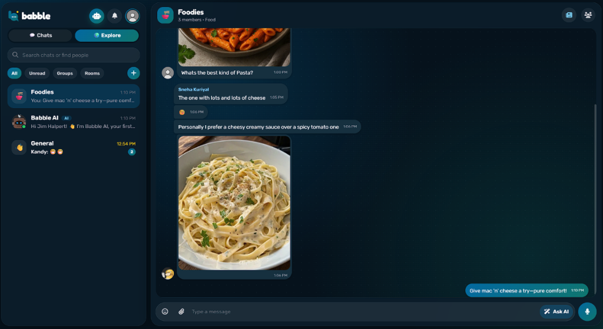
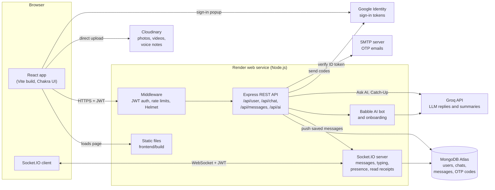

# Babble – AI-Powered Real-Time Chat Application

Babble is a full-stack real-time messaging application built with the MERN stack, Socket.IO and Groq AI. It supports one-to-one and group messaging, photos, videos and voice notes, live presence and read receipts, public community rooms, and built-in AI assistance.



---

## Live Demo

**Try Babble live:** [https://babble-cf3w.onrender.com](https://babble-cf3w.onrender.com)

> Note: the app runs on Render's free tier. If it hasn't been used recently, allow 30–60 seconds for the service to wake up.

---

## Key Features

### Real-Time Messaging and Media
- **Instant messaging:** messages are delivered by the server over Socket.IO, with typing indicators that show who is typing.
- **Photos, videos and voice notes:** attach media or paste a screenshot, add a caption, or record a voice note in the browser. Files are stored on Cloudinary.
- **Read receipts:** one tick when a message is sent, two ticks once everyone in the chat has seen it. Unread counts are kept on the server, so they survive a page reload.
- **Presence:** online status and "last seen" times for the people you chat with.
- **Message layout:** grouped bubbles, timestamps and day separators (Today, Yesterday, dates).

### Groups and Communities
- **Group chats:** create groups, rename them, and add or remove members. If the admin leaves, the group passes to the next member.
- **Explore page:** browse public community rooms by category (Hangout, Study, Tech, Gaming, Music and more), see member and online counts, or join a random room with "Surprise me".
- **Create a community:** anyone can start a public room with a name, emoji, description and category.

### AI Assistance (Groq API)
- **Babble AI contact:** every new account starts with an AI contact that answers questions and explains how the app works.
- **Smart reply suggestions ("Ask AI"):** three short reply ideas based on the recent conversation.
- **Catch-Up summary:** summarises a chat into an overview plus decisions, tasks and events.

### Authentication and Onboarding
- **Email and password with OTP:** sign-up requires a one-time code sent by email. Codes are hashed, expire after 10 minutes and allow 5 attempts.
- **Optional two-step login:** users can require an emailed code on every password login.
- **Google sign-in:** Google ID tokens are verified on the server.
- **Invite links and QR codes:** a friend who signs up through your link lands straight in a chat with you.

### Personalisation and UX
- **Chat themes:** 8 wallpaper and colour themes per chat, shared with everyone in that chat.
- **Chat list search and filters:** search chats or find new people, and filter by All, Unread, Groups or Rooms.
- **Responsive design:** works on phones and desktops.

---

## Tech Stack

### Frontend
- **Framework:** React 19, bundled with Vite
- **UI components:** Chakra UI v3, Emotion
- **Networking and real-time:** Axios, Socket.IO client
- **Auth and media:** `@react-oauth/google`, Cloudinary uploads, `qrcode.react`
- **Icons and animation:** Font Awesome 6, React Icons, React Lottie

### Backend
- **Runtime:** Node.js (20+), Express 5
- **Real-time engine:** Socket.IO (connections require a valid JWT)
- **Database:** MongoDB with Mongoose
- **Authentication:** JSON Web Tokens, bcrypt.js, Google Auth Library
- **Email delivery:** Nodemailer (OTP codes)
- **AI integration:** Groq SDK (default model `openai/gpt-oss-20b`, configurable with `GROQ_MODEL`)
- **Security:** rate limiting, Helmet security headers, input validation, membership checks on every chat route

---

## System Architecture



**How a message travels**
1. The browser sends the message to `POST /api/messages`. Any photo, video or voice note has already been uploaded straight to Cloudinary; the API only accepts media links from the app's own Cloudinary account.
2. The API checks the sender is a member of the chat, saves the message in MongoDB, and updates the chat's latest message.
3. The server, not the sender's browser, pushes the saved message to every other member over Socket.IO. This stops anyone from faking messages as someone else.
4. When a recipient opens the chat, `PUT /api/messages/:chatId/read` records it, and the sender's ticks change to "seen" in real time.
5. In a chat with Babble AI, the server also asks Groq for a reply in the background and delivers it over the socket like any other message.

---

## Getting Started Locally

### Prerequisites
- Node.js 20 or newer
- A MongoDB connection string (local or MongoDB Atlas)
- A Groq API key (free at [console.groq.com](https://console.groq.com))

### 1. Clone the repository
```bash
git clone https://github.com/Sneha07k/Babble-Real-Time-Chat-App.git
cd Babble-Real-Time-Chat-App
```

### 2. Configure environment variables
Copy the example files in the root and frontend folders:
```bash
cp .env.example .env
cp frontend/.env.example frontend/.env
```
Fill in `.env` with your MongoDB URI, JWT secret and Groq API key. Google sign-in and SMTP email are optional in development; without SMTP, sign-up codes are printed in the backend terminal. Never commit `.env` files.

### 3. Install dependencies
```bash
# Backend
npm install

# Frontend
cd frontend
npm install
cd ..
```

### 4. Run the application
Run the backend and frontend in two terminals:

```bash
# Terminal 1: backend on port 5000 (restarts on changes)
npm run server

# Terminal 2: frontend on port 3000 (Vite)
cd frontend
npm start
```

Visit `http://localhost:3000` to use Babble.

### Production build
```bash
npm run build   # installs everything and builds the frontend into frontend/build
npm start       # one server for the API, the live socket and the website
```

---

## License
This project is open-source and available under the [MIT License](LICENSE).
